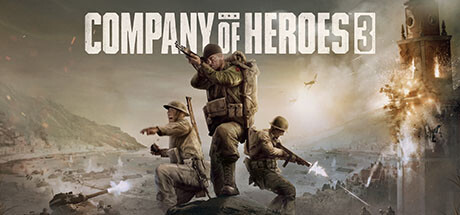

**Company of Heroes is the critically acclaimed WWII RTS featuring dynamic front lines, persistent destructible environments, and realistic unit veterancy in the Normandy campaign. Widely considered one of the greatest RTS games ever made.**

---

## 📖 About

Company of Heroes is the critically acclaimed WWII RTS featuring dynamic front lines, persistent destructible environments, and realistic unit veterancy in the Normandy campaign. Widely considered one of the greatest RTS games ever made.

## ⚠️ Problems Without Trainer

| Problem | Status |
|---------|--------|
| **Cover Dependency** — Units outside cover take dramatically increased casualties quickly | ✅ Solved |
| **Fuel Point Control** — Losing vehicle fuel points prevents fielding armored units entirely | ✅ Solved |
| **German Tank Counter** — Allied players must learn exactly which units effectively counter German armor | ✅ Solved |
| **Point Bleed** — Losing victory points while holding none causes rapid resource bleed to defeat | ✅ Solved |

## ✅ Solution

The **Company of Heroes Trainer** solves all these issues by giving you complete control over the game.

## 🎯 Full Feature List

- Unlimited Resources
- God Mode / Invincibility
- Instant Skill Cooldown
- One-Hit Kill
- Freeze Game Timer
- Unlock All Items & Achievements
- Custom Speed Multiplier
- Save State Anywhere

## 🚀 Quick Start

1. **Disable Windows Defender** temporarily (trainer may trigger false positive)
2. Download the trainer from the button above
3. Launch Company of Heroes
4. Run the trainer as Administrator
5. Activate desired cheats with hotkeys

## 💎 Free vs Paid

| Feature | Free | Pro |
|---------|------|-----|
| Basic God Mode | ✅ | ✅ |
| Unlimited Resources | ✅ | ✅ |
| All Advanced Cheats | ❌ | ✅ |
| Auto-Updates | ❌ | ✅ |
| Priority Support | ❌ | ✅ |

## 💻 Requirements

- Windows 10/11 (64-bit)
- Company of Heroes (any version)
- .NET Framework 4.8+
- DirectX 11+

## 🍎 macOS

macOS users can use our alternative tool:

## ⚖️ Legal

This trainer is for educational and single-player use only. Use responsibly.

---

